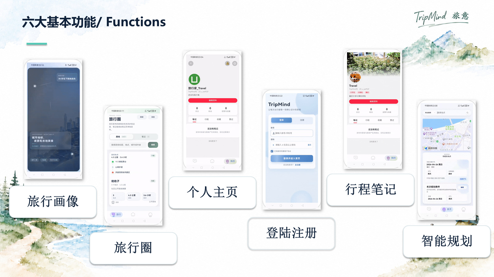
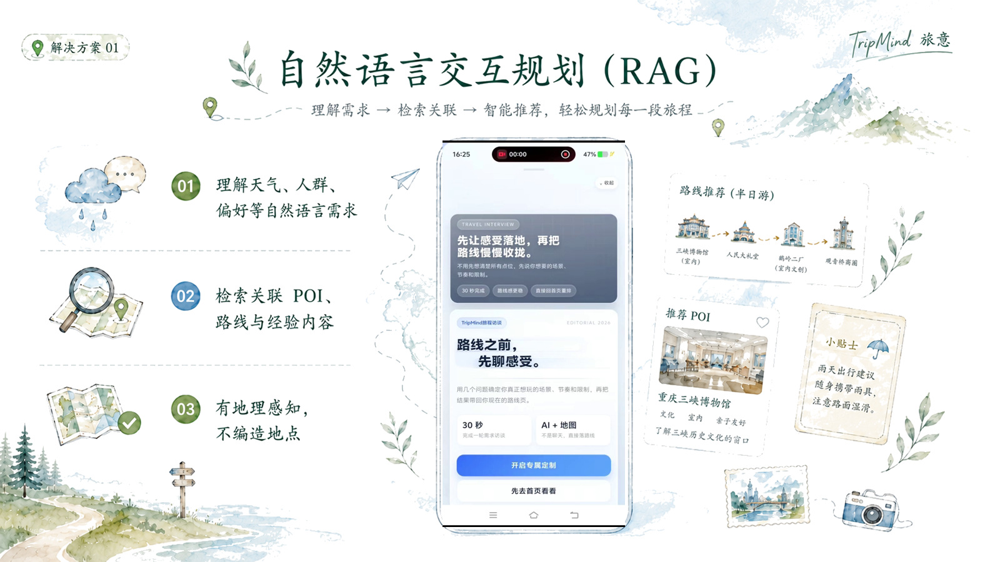
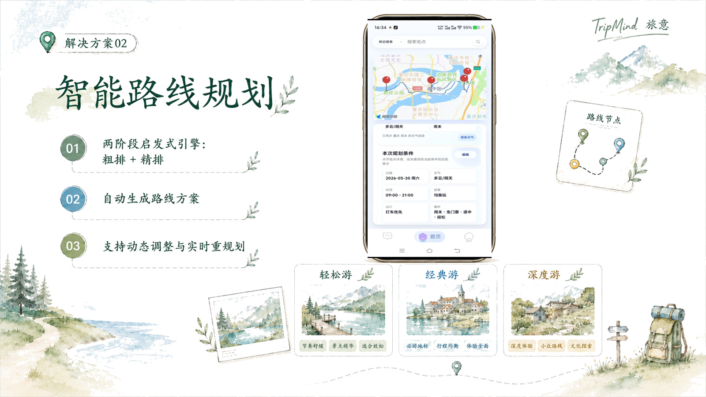
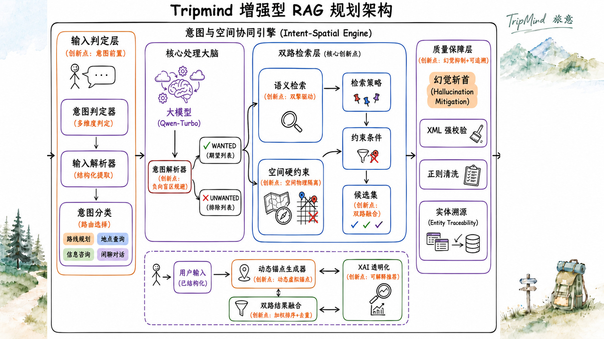
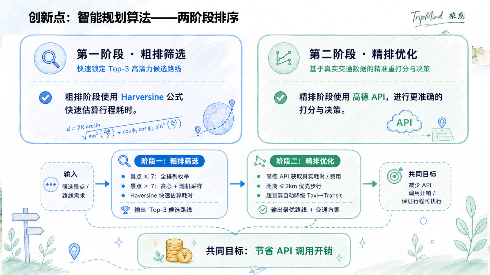
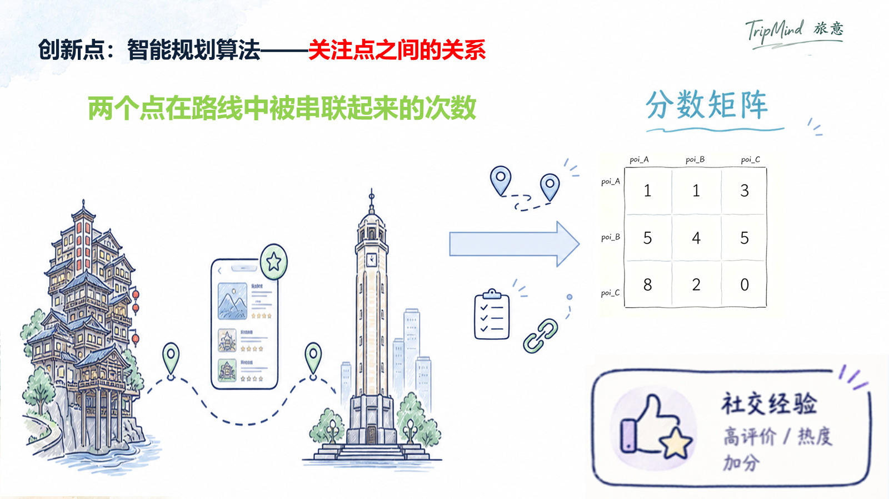
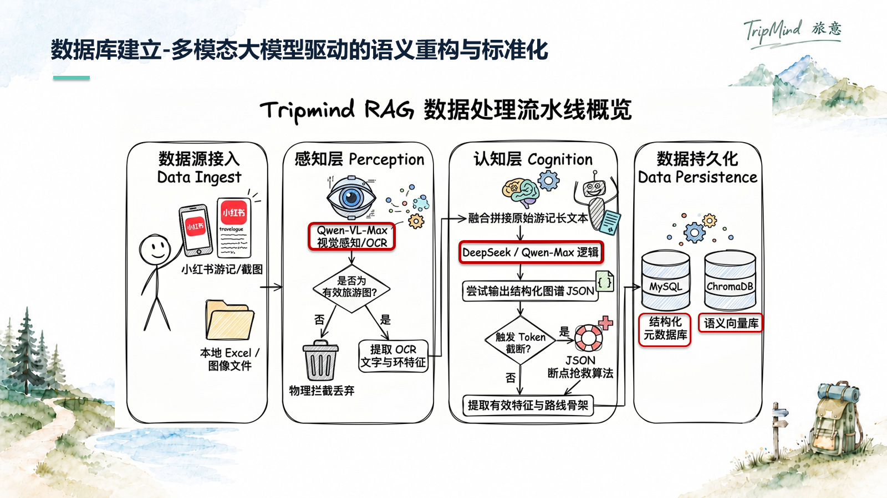

# TripMind 旅意

### 智能旅行路线规划 App

让路线规划更贴近真实出行

**自然语言规划 · 增强 RAG · 智能路线排序 · 旅行分享与复用**

[项目介绍](#项目介绍) · [功能展示](#功能展示) · [技术方案](#技术方案) · [资料下载](#资料下载)

## 项目介绍

**TripMind（旅意）**是一款面向真实出行场景的智能旅行路线规划 App。项目结合自然语言交互、检索增强生成（RAG）与路线规划算法，将用户的旅行偏好转化为可查看、可调整、可分享的行程。

旅行规划往往需要反复查攻略、筛选景点、核对地点，再逐个添加到地图。TripMind 围绕这些环节提供连续的使用流程：表达需求、获取推荐、生成路线、地图查看，以及分享与复用。

例如，用户可以用“下雨天，带老人，想轻松一些”描述需求，系统解析天气、人群与偏好，检索相关地点，并结合空间和出行约束形成规划方案。

### 项目解决的问题

| 出行中的问题 | TripMind 的处理方式 |
| --- | --- |
| 需求复杂，关键词搜索难以准确表达 | 理解自然语言中的人群、天气、偏好及排除条件，检索相关 POI |
| 路线只考虑顺路，难以兼顾游玩体验 | 综合交通耗时、时间窗、疲劳、预算与社交经验进行路线评分 |
| 攻略中的地点需要手动逐个输入地图 | 自动识别路线中的地点及顺序，一键生成地图路线 |
| 看到了优质路线，仍需重新整理 | 复制他人发布的路线生成自己的行程，再按需求编辑 |

## 功能展示

### 六大基本功能

| 功能模块 | 功能说明 |
| --- | --- |
| 旅行画像 | 记录旅行偏好，为个性化规划提供依据 |
| 登录注册 | 提供账户注册与登录入口 |
| 智能规划 | 根据需求生成路线，在地图中查看并调整行程 |
| 行程笔记 | 记录和展示旅行内容 |
| 旅行圈 | 浏览旅行分享，发现并复用他人的路线 |
| 个人主页 | 展示个人资料与旅行相关内容 |

### 核心使用场景

<table>
  <tr>
    <td width="50%" valign="top">
      <h4>💬 自然语言交互规划</h4>
      
      
理解天气、人群与偏好等描述，关联地点、路线与经验内容，让推荐更符合具体出行需求。

    </td>
    <td width="50%" valign="top">
      <h4>🗺️ 智能路线规划</h4>
      
      
通过两阶段规划生成路线方案，兼顾多项出行因素，支持手动调整与实时重规划。

    </td>
  </tr>
  <tr>
    <td width="50%" valign="top">
      <h4>📍 一键上图</h4>
      
      
从文字路线中识别地点及其顺序，快速转换为地图中的路线，减少重复录入。

    </td>
    <td width="50%" valign="top">
      <h4>🔁 一键复用</h4>
      
      
将他人发布的路线复制为自己的行程，支持二次编辑和个性化调整。

    </td>
  </tr>
</table>

## 技术方案

### 1. 意图与空间协同的增强 RAG

TripMind 将语义理解与地理空间约束结合，先明确用户想去哪里、排除什么，再筛选符合出行条件的候选地点。

- **需求结构化**：判定输入意图，解析偏好、地点和时间等约束，区分希望包含与需要排除的条件。
- **双路检索**：语义检索寻找符合需求的地点，空间硬约束筛选地理位置合理、可达的候选点。
- **结果校验**：通过格式校验、正则清洗与实体溯源，过滤格式异常和无法对应到真实地点的结果。
- **规划衔接**：将检索候选集交给路线规划模块，支持后续路线生成与调整。

### 2. 两阶段路线排序

路线规划采用“粗排筛选 + 精排优化”，先缩小候选范围，再获取更准确的交通信息，减少外部接口调用开销。

| 阶段 | 处理方式 | 作用 |
| --- | --- | --- |
| 粗排 | 使用 Haversine 公式快速估算距离与行程耗时，筛选 Top-3 候选路线 | 降低候选路线的评估成本 |
| 精排 | 调用高德 API 获取交通耗时、费用等信息，进一步评分与决策 | 输出路线及交通方案 |

综合评分考虑**交通耗时、时间窗、疲劳、预算和社交经验**等因素。PPT 同时展示了基于 Optuna 的参数优化，以及利用用户路线修改反馈更新规划参数的迭代思路。

### 3. 将地点之间的关系纳入评分

独立的景点评分难以表达一整条路线的体验。TripMind 关注两个 POI 在已有路线中被串联的情况，将共现关系组织为分数矩阵，作为路线评分中的社交经验信号。

这一设计用于补充风格是否一致、组合是否顺路等难以直接量化的信息，让规划参考已有旅行路线的组合经验。

<strong>展开查看：多模态数据处理与技术组件</strong>

### 多模态数据处理

PPT 展示的数据流水线从旅游图文资料中提取信息，通过多模态感知、语义重构和结构化处理，形成供检索与规划使用的数据。

| 环节 | PPT 中展示的技术或处理方式 |
| --- | --- |
| 数据接入 | 旅游图文资料、本地 Excel 与图像文件 |
| 视觉感知 | Qwen-VL-Max，图像理解与 OCR |
| 语义重构 | DeepSeek / Qwen-Max，图文融合与结构化 JSON 输出 |
| 需求理解 | Qwen-Turbo，意图解析与需求结构化 |
| 数据存储 | MySQL 结构化数据、ChromaDB 语义向量库 |
| 地理约束 | GIS 空间筛选与地点可达性约束 |
| 交通规划 | Haversine 距离估算、高德 API 精细评估 |
| 参数优化 | Optuna 参数搜索与用户反馈迭代 |

## 资料下载

**项目分享链接：[夸克网盘 · TripMind 项目资料](https://pan.quark.cn/s/074f4212eefd)**

项目相关资料请通过上述链接获取，具体文件以分享页面为准。

## 关于本项目说明

本 README 根据项目演示文稿整理，展示项目定位、功能界面与技术设计。文中图片均为原 PPT 的页面截图。

部署方式、环境变量与依赖版本请以项目源码及配套文档为准。

---

<strong>TripMind 旅意</strong> 
让路线规划更贴近真实出行

